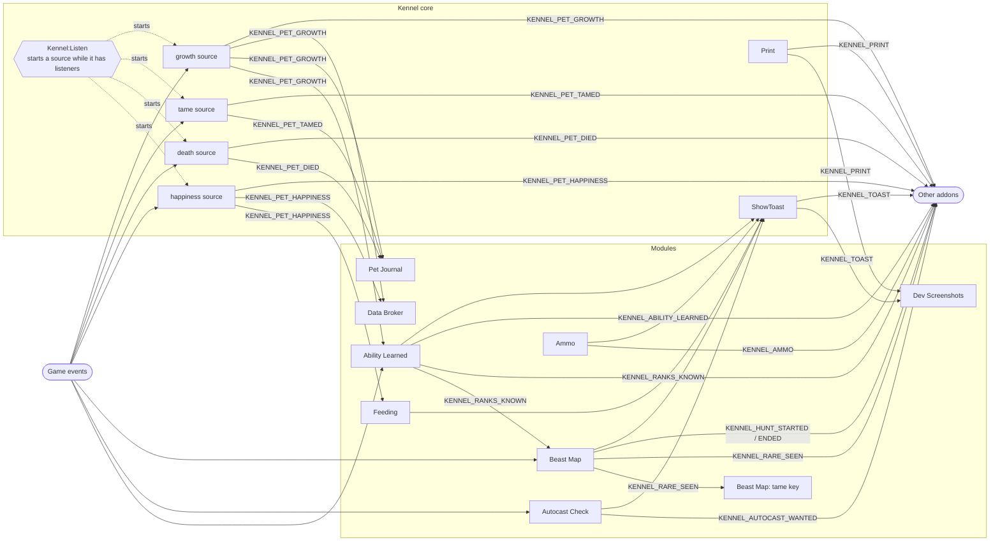

# Hooking into Kennel

Kennel tells other addons what it does through
[AceEvent-3.0](https://www.wowace.com/projects/ace3/pages/api/ace-event-3-0)
messages. Any addon can listen; Kennel does not have to know about it.

## How to listen

Listen through Kennel itself:

```lua
local Kennel = LibStub("AceAddon-3.0"):GetAddon("Kennel", true)
Kennel:Listen(owner, "KENNEL_PET_HAPPINESS", function(message, event) ... end)
Kennel:StopListening(owner)                          -- every message of this owner
Kennel:StopListening(owner, "KENNEL_PET_HAPPINESS")  -- just this one
```

`owner` is any table of yours: the key `StopListening` takes. The handler is a
function, or the name of a method on `owner`. It gets the message name and
**one table** with the details. Messages are sent at once (synchronously):
your handler runs before Kennel goes on, so for `KENNEL_TOAST` it can still
change the toast.

Some messages come from the **core** (marked *core* below): the core works
them out from game events, and only while something listens through
`Kennel:Listen`. Kennel's own modules listen the same way, so the work is done
once for all of them. The other messages come from a module, and only while
that module is switched on.

A plain AceEvent `RegisterMessage` hears every message too, but a core
message only while something else keeps it going through `Listen`; use
`Listen`.

Put `## OptionalDeps: Kennel` in your `.toc` so Kennel loads first.

## How the messages flow



Game events reach the modules and the core's sources. A source runs only
while something listens to its message; modules and other addons listen the
same way, through `Kennel:Listen`.

## Types

Each message's table is a data transfer object with a fixed shape.
[KennelMessages.lua](KennelMessages.lua), next to this file, describes them
for the Lua language server (LuaLS, or the WoW Lua LS): a `Kennel...Event`
class per message (`KennelToastEvent`, `KennelPetGrowthEvent`, ...), and
`KennelToastInfo` for the toast. It ships with Kennel and is never loaded in game. Point your
workspace at it, for example in `.luarc.json`:

```json
{ "workspace.library": ["../Kennel/docs"] }
```

Then annotate a handler (`---@param event KennelToastEvent`) and the editor
knows every field.

## The messages

Every table has `module`: the Kennel module it comes from (its internal name,
such as `"AbilityLearned"`), or `nil` for Kennel's core. Fields may be added
later; the ones listed here keep their name and meaning.

### `KENNEL_TOAST`

A toast is about to show, or to wait for the one that is up.

| Field | Type | |
|---|---|---|
| `module` | string? | the part of the toast's key before the colon |
| `toast` | table | Kennel's own toast: `key`, `type` (`"<Module>:<kind>"`), `source`, `title`, `text`, `hint`, `icon`, `accent`, `sound`, `portrait`, `screenshot`. Change it and the toast shows the change. |

### `KENNEL_PRINT`

Kennel printed a line in chat.

| Field | Type | |
|---|---|---|
| `module` | string? | the module that said it; `nil` for the core |
| `line` | string | the line as printed, without Kennel's chat prefix |

### `KENNEL_RANKS_KNOWN`

Ability Learned learned of pet ability ranks the hunter knows that it did not
know before. Sent once per learn, and once per opening of the Beast Training
window with everything new in it.

| Field | Type | |
|---|---|---|
| `module` | string | `"AbilityLearned"` |
| `source` | string | `"learn"` (a learn it saw) or `"training"` (the Beast Training window) |
| `ranks` | table | a list of `{ name = "Claw", rank = 2 }`; the name is in the client's language |

### `KENNEL_ABILITY_LEARNED`

Ability Learned saw the hunter learn a pet ability from a tamed beast. Sent
for every learn, also of a rank already known.

| Field | Type | |
|---|---|---|
| `module` | string | `"AbilityLearned"` |
| `name` | string | the ability, in the client's language |
| `rank` | number | 1 when the client named no rank |
| `pet` | string? | the pet that taught it; `nil` when it was not out |
| `npc` | number? | the NPC ID that pet was tamed as |
| `zone` | string? | where it happened |

### `KENNEL_PET_GROWTH` (core)

The pet out's training points total, level or loyalty level changed since
Kennel last saw that pet (kept per pet name, also across a relog: the first
check after login tells what changed while you were away). A pet seen the
first time is only noted. Going down counts too: a pet left unhappy loses
loyalty, and a lower loyalty level means fewer points, so `loyalty` and
`points` come in below `before`. Points spent at Beast Training change only
`free`, not the total, and send nothing. Ability Learned toasts from it, the
Pet Journal and the Data Broker refresh on it.

| Field | Type | |
|---|---|---|
| `pet` | string | the pet's name |
| `level` | number | |
| `loyalty` | number? | 1-6; `nil` when the client does not tell it |
| `loyaltyName` | string? | the loyalty level's name, when the client gives one |
| `points` | number | the training points total |
| `free` | number | the points not spent |
| `before` | table | `{ level, loyalty, points }` as they were |

### `KENNEL_AUTOCAST_WANTED`

What Autocast Check wants on autocast changed, or what decided it.

| Field | Type | |
|---|---|---|
| `module` | string | `"AutocastCheck"` |
| `wanted` | string | `"growl"` or `"cower"` |
| `why` | string | `"solo"` (alone, or a group outside a dungeon), `"dungeon"` (a dungeon or raid group), `"chosen"` (the KennelKite or KennelGrowl macro) |
| `before` | string | what it wanted before |

### `KENNEL_RARE_SEEN`

Beast Map saw a rare beast that teaches a rank the hunter lacks: on the
minimap, as a nameplate, the target or under the mouse. Once per spawn; sent
also with the rare toast off. Beast Map's tame key listens to it.

| Field | Type | |
|---|---|---|
| `module` | string | `"BeastMap"` |
| `npc` | number | |
| `name` | string | the client's name once it knows the beast, else English |
| `guid` | string | the creature's GUID |
| `ranks` | table | the spell IDs of the ranks it would teach |

### `KENNEL_HUNT_STARTED` and `KENNEL_HUNT_ENDED`

The hunter picked a beast to tame for one rank (Beast Map's hunt: a rank's
button in the Abilities tab, or a beast's pin), and that hunt is over: the
hunter knows the rank now, or stopped it (the button again, `/kennel hunt
stop`, or a new hunt).

| Field | Type | |
|---|---|---|
| `module` | string | `"BeastMap"` |
| `npc` | number | |
| `spellID` | number | the rank hunted for |
| `name` | string | the client's name once it knows the beast, else English |
| `reason` | string | ENDED only: `"learned"` or `"stopped"` |

### `KENNEL_AMMO`

The hunter's ammo count crossed a line set on the Ammo page: low, critically
low, or back to enough after restocking. Also once when the module starts.

| Field | Type | |
|---|---|---|
| `module` | string | `"Ammo"` |
| `count` | number | the ammo in the ammo slot, counted in the bags |
| `state` | string | `"ok"`, `"low"` or `"critical"` |
| `kind` | number | `Kennel.ammoKinds.arrow` (2: bow, crossbow) or `.bullet` (3: gun), the Projectile item subclass |

### `KENNEL_PET_HAPPINESS` (core)

The pet out's happiness changed. Feeding and the Data Broker listen.

| Field | Type | |
|---|---|---|
| `happiness` | number | `Kennel.happiness.unhappy` (1), `.content` (2) or `.happy` (3) |
| `before` | number? | `nil` for a pet just out |

### `KENNEL_PET_DIED` (core)

The pet out died: seen going from alive to dead. The Pet Journal counts it.

| Field | Type | |
|---|---|---|
| `pet` | string? | its name |

### `KENNEL_PET_TAMED` (core)

The pet that came out after a Tame Beast cast. The Pet Journal notes it.

| Field | Type | |
|---|---|---|
| `pet` | string? | its name |
| `npc` | number? | the NPC ID it was tamed as |
| `petNumber` | number? | the number it keeps through renames and the stable; `nil` until your next relog, while the pet still has the beast's GUID |

## Example

A small addon that keeps a log of the ranks the hunter learns, says them in
party chat, and puts a mark on every Kennel toast about a dead pet.

`KennelHook.toc`:

```
## Interface: 16001
## Title: Kennel Hook
## OptionalDeps: Kennel
## SavedVariables: KennelHookLog

KennelHook.lua
```

`KennelHook.lua`:

```lua
local Kennel = LibStub and LibStub("AceAddon-3.0"):GetAddon("Kennel", true)
if not Kennel then return end -- Kennel is not loaded

local hook = {}
KennelHookLog = KennelHookLog or {}

-- Ranks the hunter now knows: keep them, and tell the group about a new learn.
---@param event KennelRanksKnownEvent
Kennel:Listen(hook, "KENNEL_RANKS_KNOWN", function(_, event)
    for _, known in ipairs(event.ranks) do
        table.insert(KennelHookLog, ("%s %s rank %d"):format(date("%Y-%m-%d"), known.name, known.rank))
        if event.source == "learn" and IsInGroup() then
            SendChatMessage(("learned %s rank %d"):format(known.name, known.rank), "PARTY")
        end
    end
end)

-- Every toast passes here before it shows: mark Care Button's dead-pet toast.
---@param event KennelToastEvent
Kennel:Listen(hook, "KENNEL_TOAST", function(_, event)
    if event.toast.type == "CareButton:dead" then
        event.toast.title = "|TInterface\\TargetingFrame\\UI-RaidTargetingIcon_8:0|t " .. event.toast.title
    end
end)

-- A pet left unhappy loses loyalty, and with it training points.
---@param event KennelPetGrowthEvent
Kennel:Listen(hook, "KENNEL_PET_GROWTH", function(_, event)
    if event.points < event.before.points then
        print(("%s lost %d training points: feed it."):format(event.pet, event.before.points - event.points))
    end
end)

-- The core works this one out only while someone listens.
---@param event KennelPetDiedEvent
Kennel:Listen(hook, "KENNEL_PET_DIED", function(_, event)
    PlaySound(SOUNDKIT.RAID_WARNING)
end)
```

Stop listening with `Kennel:StopListening(hook, "KENNEL_TOAST")`, or to
everything at once with `Kennel:StopListening(hook)`.
